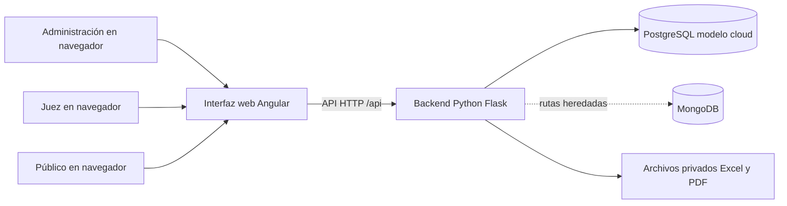
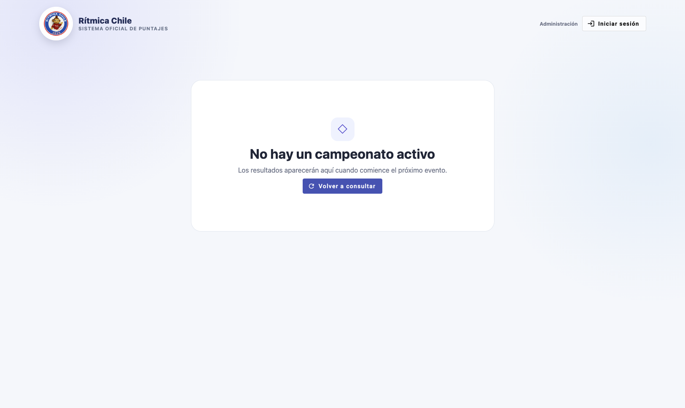
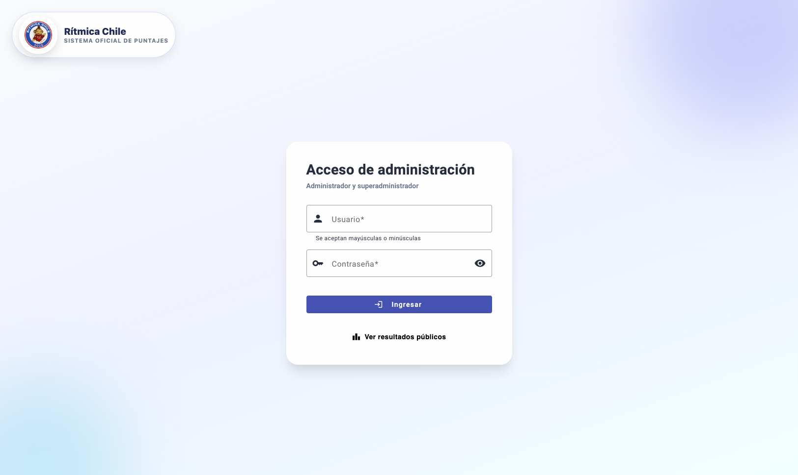
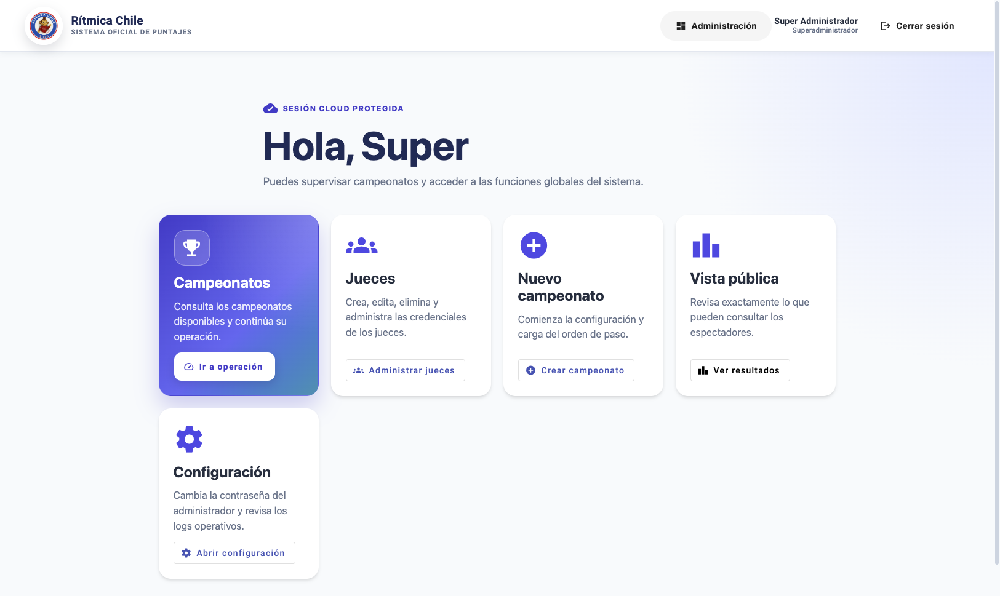
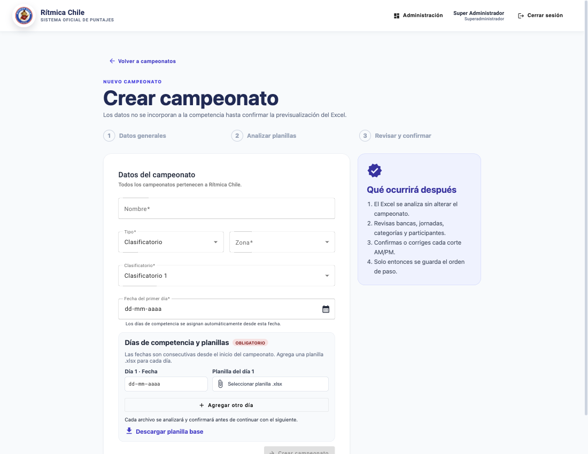
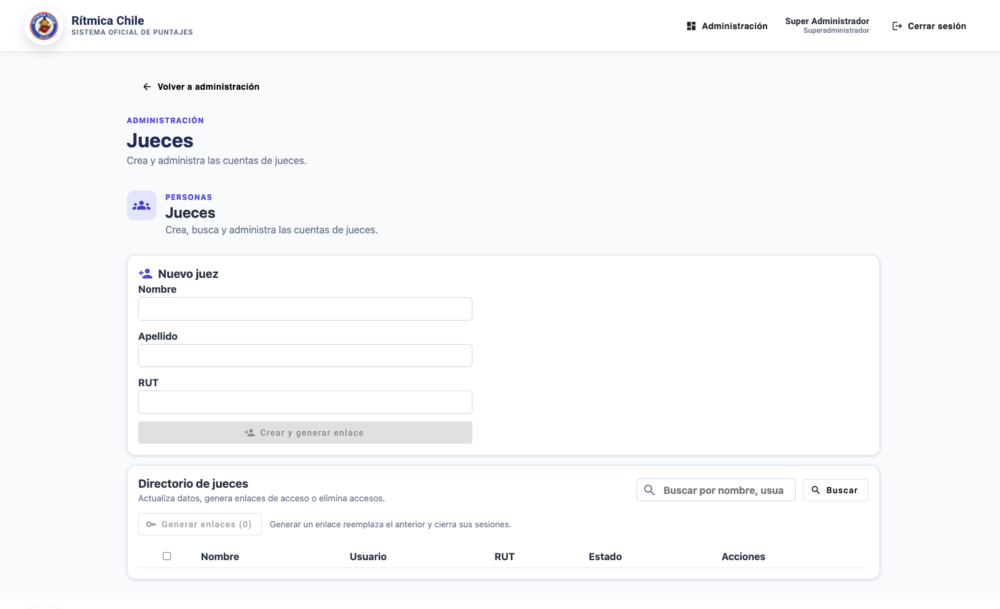
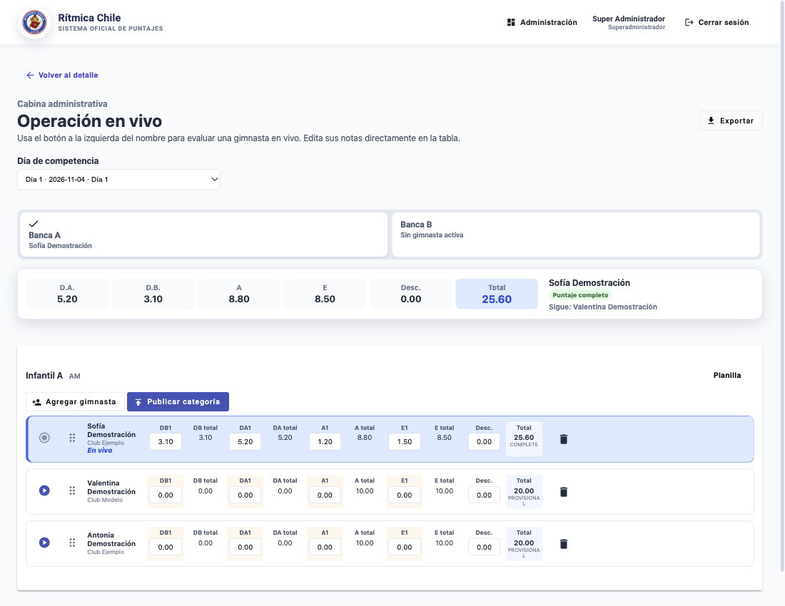
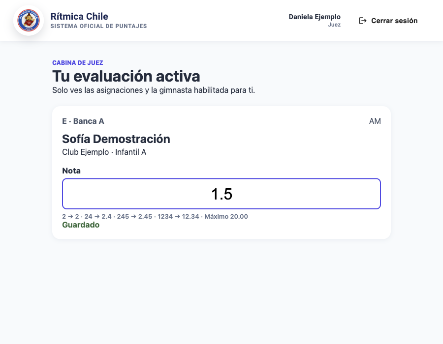

# Rítmica Chile
## Arquitectura y guía de funcionamiento

**Destinatarios:** personas externas que necesitan comprender el sistema y el desarrollo de un campeonato.  
**Revisión:** 4 de noviembre de 2026.

Rítmica Chile es una aplicación web para organizar campeonatos de gimnasia rítmica, cargar órdenes de paso, coordinar jueces, registrar puntajes y consultar resultados. La administración prepara y dirige la competencia; cada juez accede a su propia cabina, y el público consulta los resultados publicados.

Esta guía describe la implementación encontrada en el repositorio. Las capturas se obtuvieron en una copia local aislada, a partir de imágenes Docker disponibles del 16 de octubre de 2026. Son pantallas reales y pueden diferir en detalles del código actual. Para ilustrar la operación se prepararon datos ficticios directamente en la base de pruebas y se registró una nota mediante la API autenticada del juez; se verificó su aparición en ambas cabinas. No se ejecutó una competencia completa.

## 1. Arquitectura del sistema

El navegador muestra la interfaz Angular. Esta se comunica mediante HTTP con una API en Python y Flask, que valida permisos, administra la competencia y calcula los resultados. El modelo cloud guarda sus datos en PostgreSQL; parte de la implementación anterior conserva rutas y datos en MongoDB durante la transición. Los archivos de importación y exportación se guardan en almacenamiento local o privado en la nube, según la configuración.

En producción, el frontend se entrega como archivos estáticos y las solicitudes `/api` se encaminan al backend bajo el mismo origen. La infraestructura incluida en el repositorio prepara un despliegue en Google Cloud con Cloud Run, Cloud SQL para PostgreSQL, Cloud Storage privado, balanceador HTTPS, CDN y Secret Manager. Esto describe la configuración disponible en el proyecto; no certifica que esté desplegada ni cuál es su estado actual.

### Tecnologías principales

| Componente | Tecnología | Función |
|---|---|---|
| Interfaz | Angular 17, TypeScript, Angular Material | Pantallas, formularios, navegación y controles. |
| API | Python y Flask | Autenticación, reglas de negocio, importación, operación y publicación. |
| Datos cloud | PostgreSQL y SQLAlchemy | Persistencia del modelo normalizado y cálculos asociados. |
| Datos heredados | MongoDB | Compatibilidad temporal con la aplicación anterior. |
| Archivos | Excel, openpyxl y ReportLab | Entrada de órdenes de paso y generación de archivos Excel y PDF. |
| Entrega | Docker, Nginx y Google Cloud | Empaquetado local y componentes previstos para despliegue. |

### Contenedores en desarrollo

Un contenedor empaqueta una aplicación con sus dependencias para ejecutarla de manera reproducible. El archivo `docker-compose.yml` de la raíz describe cuatro servicios conectados en una red privada:

- **frontend:** construye Angular y sirve la aplicación con Nginx; se expone en el puerto 4200.
- **backend:** ejecuta Flask y atiende la API en el puerto 8080. Espera a que las bases de datos estén disponibles.
- **postgres:** PostgreSQL 16, con un volumen persistente para el modelo cloud, en el puerto 5432.
- **mongo:** MongoDB 6, con su propio volumen persistente, en el puerto 27017; se conserva para las rutas heredadas.

Los volúmenes permiten conservar datos al recrear contenedores. La carpeta `deploy-ritmicachile` incluye otra configuración más antigua basada en MongoDB; no debe confundirse con el Compose de la raíz ni asumirse como despliegue cloud actual.

### Seguridad y acceso

El administrador y el superadministrador inician sesión con usuario y contraseña. La sesión utiliza cookies HttpOnly y las operaciones de escritura incorporan protección CSRF. Las rutas privadas comprueban el rol. El juez ingresa mediante un enlace personal y solo puede operar dentro de su asignación y ventana de acceso. El enlace debe entregarse individualmente: quien lo posee puede utilizarlo durante el turno permitido. Al generar uno nuevo se invalida el anterior y se cierran sus sesiones.

## 2. Personas y flujo general

| Perfil | Responsabilidad principal |
|---|---|
| Superadministrador | Configuración global, cuentas y supervisión; también puede administrar campeonatos. |
| Administrador | Prepara campeonatos, asigna jueces, conduce la operación y publica o exporta resultados. |
| Juez | Consulta su asignación y registra su propia nota para la gimnasta habilitada. |
| Público | Consulta los resultados que se han publicado, sin iniciar sesión. |

El recorrido habitual es: **crear campeonato → cargar y revisar planillas → asignar jueces → activar → seleccionar gimnasta → registrar y revisar notas → publicar → consultar o exportar**. El campeonato puede pausarse y cerrarse. Solo se permite uno activo a la vez.

## 3. Acceder al sistema

La página inicial es la vista pública. Si no existe un campeonato activo, muestra un mensaje y permite volver a consultar. Cuando hay información publicada, permite buscar y elegir categorías y consultar sus resultados.

*Figura 1. Página pública en una instalación de prueba sin campeonato activo.*

Para entrar como administrador:

1. En la página pública, seleccione **Iniciar sesión**.
2. Introduzca su usuario y contraseña y pulse **Ingresar**.
3. Desde el menú de administración, acceda a campeonatos, jueces o creación de un campeonato. Las opciones visibles dependen del rol.

*Figura 2. Formulario de acceso para administrador y superadministrador.*

*Figura 3. Menú de una cuenta de superadministrador en la instalación de prueba.*

## 4. Crear un campeonato y cargar el orden de paso

1. En el menú, seleccione **Crear campeonato**.
2. Complete el nombre, tipo, zona y fecha inicial, además de los campos adicionales que correspondan al tipo seleccionado.
3. Seleccione una planilla `.xlsx` para cada día. Puede agregar días y descargar la planilla base desde el formulario.
4. Continúe con la creación y espere el análisis. La aplicación muestra una previsualización antes de incorporar el orden de paso.
5. Revise los días, bancas, jornadas, categorías y participantes detectados. Confirme o corrija la separación entre AM y PM cuando corresponda y confirme cada revisión.
6. Abra el detalle del campeonato para revisar lo importado antes de iniciar la competencia.

*Figura 4. Formulario de creación y carga de planillas. La captura muestra el formulario vacío.*

La previsualización evita que un corte incorrecto se incorpore sin revisión. Si el análisis de una planilla falla, la interfaz permite reemplazarla y reintentar. El formato de entrada se detalla en `FORMATO_EXCEL.md` y la plantilla está disponible desde la aplicación.

## 5. Preparar jueces y asignaciones

En **Administración → Jueces** se encuentra el directorio. Desde allí se pueden buscar jueces y gestionar sus datos y enlaces. El superadministrador dispone del formulario para crear una cuenta global. La aplicación también contempla la creación de un juez durante una asignación.

*Figura 5. Gestión de jueces; el directorio está vacío en la instalación de prueba.*

Para preparar un turno:

1. Abra el detalle del campeonato y busque la sección **Jueces asignados**.
2. Seleccione el día, banca, jornada y rol; busque al juez existente o complete los datos del nuevo juez cuando la interfaz lo permita.
3. Guarde la asignación. Prepare y entregue a cada juez su enlace personal desde la bandeja de enlaces o el directorio.
4. Compruebe las asignaciones y ventanas antes de activar el campeonato. Una reasignación durante la competencia se aplica desde la categoría siguiente, preservando la referencia histórica del juez anterior.

La bandeja muestra los enlaces recién generados durante la sesión administrativa. Una vez descartados, no se puede recuperar el secreto anterior: se debe generar otro, lo que revoca el enlace previo. En un campeonato real, el enlace compartido debe usar la dirección pública del sistema; `localhost` solo funciona en el mismo equipo.

## 6. Dirigir la competencia y registrar notas

Desde el detalle del campeonato, active el evento y abra **Operación en vivo**. Seleccione el día y la banca A o B. La pantalla presenta categorías y gimnastas de esa banca y permite elegir cuál está siendo evaluada. El indicador superior muestra la gimnasta activa, los componentes del puntaje y las notas pendientes o el estado de cálculo.

*Figura 6. Competencia ficticia: la banca A tiene una gimnasta activa. La grilla muestra sus notas y el total calculado; las siguientes gimnastas están pendientes.*

El procedimiento habitual es:

1. Seleccionar la primera gimnasta del orden de paso mediante el control junto a su nombre.
2. Los jueces asignados abren su enlace y consultan **Tu evaluación activa**. Su cabina muestra únicamente el contexto que les corresponde y la gimnasta habilitada.
3. Cada juez con un rol puntuable ingresa y guarda su nota. El servidor comprueba que el campeonato esté activo y que la asignación y la activación sigan siendo válidas.
4. La administración observa las notas y el total en la planilla. Puede completar o corregir notas, aplicar descuentos y atender discrepancias conforme a sus permisos y al estado del campeonato.
5. Cuando corresponda, seleccione la siguiente gimnasta y repita el proceso. Cambiar de gimnasta invalida los borradores asociados a una activación anterior.

*Figura 7. Cabina de una jueza ficticia de ejecución. La nota 1,50 fue registrada mediante la API de prueba y aparece guardada; en la figura 6 se ve su reflejo en la planilla administrativa.*

La grilla administrativa permite agregar o eliminar gimnastas y cambiar el orden, dentro de los estados permitidos. Las notas individuales se registran con hasta dos decimales; el sistema acepta coma o punto. El cálculo es autoritativo en el backend: las notas y descuentos actualizan el resumen del puntaje. Los roles Línea y Planilla no generan una nota puntuable en la cabina del juez.

**Lectura de las notas:** DA y DB corresponden a componentes de dificultad; A y E representan artística y ejecución. La implementación contempla un descuento separado y alertas o resoluciones de discrepancias. Las reglas exactas deben contrastarse con la normativa deportiva aplicable y la configuración vigente antes de utilizar el sistema en una competencia oficial.

## 7. Publicar y consultar resultados

En la planilla de una categoría, la administración selecciona **Publicar**. La publicación es manual y corresponde a la categoría completa; guardar una nota no la publica automáticamente. El campeonato debe estar activo. Si después se corrige una nota, es necesario volver a publicar para actualizar la fotografía pública.

El público entra a la página inicial, busca una categoría o gimnasta y selecciona una categoría para consultar el listado. Puede cambiar el orden de visualización y actualizar la consulta. La información pública incluye identificación, club, orden, posición y total; no muestra las notas individuales de los jueces. Una gimnasta agregada después de la última publicación puede aparecer con total cero hasta volver a publicar; una gimnasta eliminada desaparece de la vista pública.

## 8. Exportar y cerrar

Desde **Operación en vivo**, seleccione **Exportar**. La pantalla ofrece **Exportar Excel** y **Exportar PDF**. Los documentos se generan a partir del cálculo del modelo cloud. Revise el archivo descargado antes de compartirlo. Al finalizar, la administración puede cerrar el campeonato desde su detalle; el cierre termina las activaciones abiertas y el acceso de jueces asociado a ese evento.

## 9. Alcance y referencias de esta revisión

Se revisaron el código de las rutas y pantallas Angular, servicios y documentación del backend, el Compose de la raíz y la infraestructura cloud. La copia aislada permitió verificar visualmente el acceso, la preparación, la operación y la cabina de juez. La competencia y sus asignaciones se crearon como datos de prueba y una nota se guardó mediante la API autenticada, confirmando su reflejo en la interfaz. No se verificaron de extremo a extremo la importación de planillas, la creación de asignaciones desde la interfaz, la publicación ni las descargas; sus explicaciones se basan en la implementación.

Para profundizar: `README.md`, `backend/README.md`, `docker-compose.yml`, `infra/README.md`, `src/app/app.routes.ts`, los componentes en `src/app/features/` y `FORMATO_EXCEL.md`. Algunos manuales y configuraciones del repositorio describen etapas anteriores; ante diferencias, conviene contrastar con el código y el entorno desplegado.
