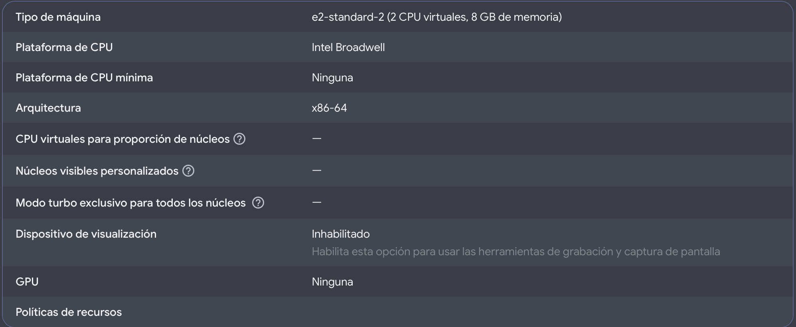

# Rítmica Chile
## Infraestructura de producción y costos de Google Cloud

**Revisión:** 4 de noviembre de 2026. **Alcance:** proyecto `ritmicachileweb` y cuenta de facturación asociada, consultados en la consola de Google Cloud. Las cifras son una fotografía de esa fecha y pueden cambiar.

El proyecto tiene una máquina virtual activa en Compute Engine. Para mantenerla encendida todo un mes, una estimación orientativa de sus componentes básicos es **USD 53,57 mensuales antes de impuestos, créditos y costos variables**. La cuenta estaba en prueba gratuita: el consumo observado se cubría con créditos, por lo que la consola mostraba un total neto de CLP 0. El costo de uso no desaparece cuando el cobro se cubre con un crédito.

Esta revisión confirmó las características de la VM y datos de facturación. No se inspeccionó el sistema operativo ni los contenedores que se ejecutan dentro de ella, por lo que no se puede afirmar desde esta evidencia qué procesos sirven la aplicación o dónde reside la base de datos de producción. Para una descripción completa del despliegue, esos puntos deben verificarse en la máquina.

## 1. Qué hay en la nube

Google Cloud agrupa los recursos de la organización en un proyecto. En el proyecto `ritmicachileweb`, la consola mostró una instancia de Compute Engine en ejecución. Una máquina virtual (VM) es un servidor alojado por Google: dispone de procesadores, memoria y un disco, y puede ejecutar un sistema operativo y aplicaciones como si fuera un servidor físico.

| Recurso observado | Configuración |
|---|---|
| Proyecto | RitmicaChileWeb (`ritmicachileweb`). |
| Máquina | `instance-20261007-183605`, activa al momento de la revisión. |
| Ubicación | Zona `us-central1-a`, región Iowa, Estados Unidos. |
| Tamaño | `e2-standard-2`: 2 CPU virtuales y 8 GB de memoria. |
| Sistema de origen | Imagen Debian 13 Trixie; arquitectura x86-64. |
| Disco de arranque | 10 GB de disco persistente balanceado. |
| Conectividad | IPv4 pública estática, red de nivel Premium; tráfico HTTP y HTTPS habilitado en la configuración de la VM. |
| Protección del disco | Política de instantáneas diaria asociada; no se verificó la retención ni una restauración. El plan de Backup and DR figura como no configurado. |

*Figura 1. Detalle de la configuración de la máquina en Google Cloud, recortado para mostrar sus características principales.*

Una CPU virtual aporta capacidad de procesamiento y la memoria mantiene datos de trabajo mientras los programas se ejecutan. El disco conserva archivos cuando el sistema se reinicia. La IP pública permite alcanzar recursos desde Internet cuando las reglas de red lo permiten; las opciones HTTP y HTTPS de la VM no demuestran por sí solas que exista un certificado válido o que la aplicación esté accesible.

## 2. Cómo se relaciona con la aplicación

La aplicación del repositorio está compuesta por una interfaz Angular y un backend Flask. Su configuración de desarrollo usa contenedores para frontend, backend y bases de datos. La VM puede alojar software y contenedores, pero la consola revisada no muestra qué componentes están instalados o activos dentro del servidor. Tampoco se comprobó el dominio, el certificado, la ruta de los datos ni el procedimiento real de despliegue. Por eso, no debe interpretarse la configuración local como un inventario confirmado de producción.

El repositorio también contiene infraestructura Terraform preparada para Cloud Run, Cloud SQL, almacenamiento privado y un balanceador HTTPS en Santiago. Esa es una **configuración prevista**, no una descripción comprobada de la VM en Iowa. La vista de servicios de Cloud Run revisada no mostró servicios en el proyecto; no se verificaron todos los servicios ni otros proyectos asociados a la cuenta.

## 3. Cómo leer la facturación

La consola de facturación mostraba una prueba gratuita con vencimiento el **6 de enero de 2027**. Al revisar el informe, quedaban **CLP 272.219** de **CLP 290.923** en créditos. La disponibilidad real depende de las condiciones de la cuenta y del consumo posterior.

| Período observado | Costo de uso antes de ahorros | Créditos o ahorros mostrados | Total neto mostrado |
|---|---|---|---|
| 1 al 31 de octubre de 2026 | CLP 16.473 | -CLP 16.473 | CLP 0 |
| 1 al 4 de noviembre de 2026 | CLP 3.366 | -CLP 3.366 | CLP 0 |

El informe agrupado por servicio para octubre mostró aproximadamente CLP 13.052 en Compute Engine, CLP 1.711 en Networking y CLP 1.711 en VM Manager; los redondeos visibles pueden generar una diferencia de un peso respecto del total. El informe consultado era de la cuenta de facturación y no se comprobó que todos sus cargos pertenecieran exclusivamente a este proyecto. Octubre no debe tratarse como un mes típico de operación continua: la VM fue creada el 7 de octubre y no se verificó su historial de encendido.

La consola proyectaba un total neto de CLP 0 para noviembre e indicaba CLP 38.326 en ahorros previstos. Esa proyección incluye créditos y depende del consumo histórico; no es una cotización ni una garantía del costo futuro. La factura definitiva puede diferir por retrasos, redondeos, impuestos, descuentos, uso y tipo de cambio.

## 4. Estimación mensual sin créditos

Para dar una referencia independiente del gasto cubierto por la prueba, se consideran 730 horas al mes, la VM activa todo el tiempo, un disco balanceado de 10 GB y una IPv4 estática en uso. Se utilizan tarifas públicas de Iowa consultadas el 4 de noviembre de 2026, en dólares estadounidenses.

| Componente | Cálculo de referencia | USD por mes |
|---|---|---|
| VM e2-standard-2 | 730 h × USD 0,06701142/h | 48,92 |
| Disco persistente balanceado | 10 GB × USD 0,10 por GB/mes | 1,00 |
| IPv4 externa estática en uso | 730 h × USD 0,005/h | 3,65 |
| Total básico orientativo | Suma de los tres componentes | **53,57** |

El total no incluye tráfico de salida a Internet, instantáneas, VM Manager, registros u otros servicios, impuestos, descuentos particulares o cambios de precio. La tarifa efectiva en CLP y la facturación final pueden diferir de una conversión directa desde USD. Si la VM se detiene, el cómputo deja de acumularse según las condiciones del servicio, pero el disco, la dirección reservada y otros recursos pueden seguir generando cargos. La estimación de USD 53,57 y la proyección de CLP 38.326 en ahorros son métodos distintos y no deben sumarse ni tratarse como equivalentes.

## 5. Operación y continuidad

Para revisar la infraestructura, entre a Google Cloud, seleccione el proyecto `ritmicachileweb` y abra **Compute Engine → Instancias de VM**. Seleccione la instancia para consultar su estado, zona, tamaño, disco, red y observabilidad. Evite detener, reiniciar o modificar la máquina durante una competencia sin una ventana de mantenimiento acordada.

Para revisar el gasto, abra **Facturación → Informes**, seleccione el período y agrupe por servicio o proyecto. Compare el costo de uso con créditos y el total neto. Si la cuenta se comparte entre proyectos, filtre el proyecto antes de atribuirle el gasto. La proyección cambia a medida que se acumula información y los créditos pueden ocultar el costo que tendrá el servicio posteriormente.

La consola muestra una política diaria asociada al disco, pero eso no prueba que exista una copia consistente de la base de datos ni que se haya ensayado una recuperación. Conviene verificar el contenido y retención de las instantáneas y realizar una restauración de prueba. También conviene documentar el inventario de servicios dentro de la VM, el dominio y HTTPS, el monitoreo, la capacidad del disco y el procedimiento de despliegue. La consola indica que el reinicio automático de la VM estaba inactivo; esto merece una revisión operativa según las necesidades del servicio.

Antes del vencimiento de la prueba, revise el estado de facturación y las condiciones de continuidad. Un presupuesto y alertas ayudan a detectar variaciones, pero no deben confundirse con un límite automático de gasto.

## 6. Fuentes y límites

Los datos particulares de la VM y de facturación provienen de la consola de Google Cloud consultada el 4 de noviembre de 2026. Las tarifas públicas se contrastaron con estas páginas oficiales:

- Google Cloud, precios de máquinas de uso general: https://cloud.google.com/products/compute/pricing/general-purpose
- Google Cloud, precios de almacenamiento en bloques: https://cloud.google.com/products/block-storage
- Google Cloud, precios de redes VPC y direcciones IPv4: https://cloud.google.com/vpc/pricing
- Google Cloud, informes y previsión de costos: https://docs.cloud.google.com/billing/docs/how-to/reports/forecasted-costs

Las características y costos de una infraestructura cloud cambian. Antes de tomar decisiones de contratación o presupuesto, actualice el cálculo con la calculadora y la cuenta de facturación correspondientes.
